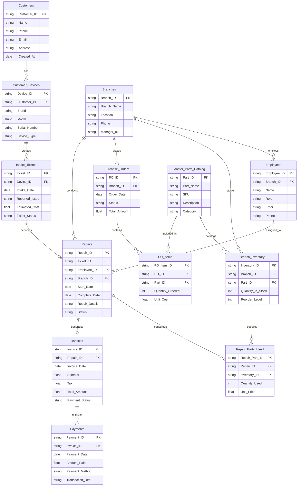

#### bytefix by @nazmulalibiswas
  Desktop ERP for multi branch electronics repair shops built with Python (Tkinter) and PostgreSQL, featuring live inventory tracking and split billing.

# BYTEFIX / SOFTWARE REQUIREMENTS SPECIFICATION

## Software Requirements Specification
### ByteFix Repair & Inventory Management - Desktop Application

| Document detail | Value | Document detail | Value |
| :--- | :--- | :--- | :--- |
| Client | ByteFix Electronics & Laptop Repair | Client Representative | Rafiq Ahmed (Owner, 3 Branches) |
| Version | 1.0 | Application type | Desktop application (Offline-first) |
| Date | 2 November 2026 | Workflow Repository | AI With SWE |

## 1. Introduction

### 1.1 Purpose
This document defines the requirements for a desktop application that manages customers, devices, repair tickets, employees, spare parts catalogs, multi-branch inventory, wholesale suppliers, purchase orders, invoices, installment/split payments, and 30-day warranty claims. It provides a standardized basis for relational database design, ERD development, SQL schema implementation, and acceptance testing.

### 1.2 Problem statement
ByteFix operates three physical electronics repair branches using disconnected Excel spreadsheets and paper receipts, making it difficult to track customer devices and drop-off accessories, control expensive spare parts inventory, prevent catalog price changes from altering historical repair invoices, view stock counts across sister branches, and track advance deposits, split payments, and 30-day repeat warranty repairs.

### 1.3 Objectives
Maintain multi-branch repair, inventory, procurement, and billing records in a unified relational database; eliminate untracked spare part consumption and manual invoice calculations; preserve historical retail and wholesale part pricing; and provide fast front-desk searches, cross-branch stock visibility, and operational reports.

*Version 1.0 | ByteFix Repair & Inventory Management SRS*  
*Page 1 of 9*

### 1.4 Intended users

| User | Responsibilities |
| :--- | :--- |
| Receptionist (Front-desk staff) | Register customers and devices, record physical condition and accessories, open repair tickets, generate invoices, record advance deposits and final split payments, and open 30-day warranty tickets. |
| Technicians (Lead & Junior) | Inspect and diagnose devices, update repair ticket status, log spare parts consumed from branch inventory, and set repair labor fees. |
| Store Manager | Maintain employee and supplier records, update the spare parts catalog, monitor cross-branch inventory and reorder alerts, create purchase orders, receive stock shipments, and review reports. |

### 1.5 Scope

| Included | Excluded from Version 1 |
| :--- | :--- |
| Customer and multi-device intake management | Customer-facing online booking website and mobile app |
| Repair ticket tracking and lead/helper technician assignment | Automated third-party payment gateway integration |
| Spare parts catalog and per-branch stock tracking | Employee payroll, attendance, and commission calculation |
| Supplier management and purchase order restocking | Automated external courier and shipping integration |
| Invoicing, deposits, split payments, and 30-day warranty links | Automated refund processing and accounting ledger export |

## 2. Overall Description

### 2.1 Product overview
The application shall provide desktop forms for entering intake, diagnostic, inventory, procurement, and payment information; structured tables for filtering active tickets and branch stock levels; and printable job sheets, invoices, and operational summaries. Persistent records shall be stored in a normalized relational database.

### 2.2 Operating environment
The application shall run on Windows and macOS desktop computers with keyboard and mouse input across all three ByteFix branches. Core front-desk and back-room functions shall operate offline-first using local database storage with central synchronization across branches.

*Version 1.0 | ByteFix Repair & Inventory Management SRS*  
*Page 2 of 9*

### 2.3 Assumptions and constraints
Version 1 will serve ByteFix's three repair branches and be operated by authorized staff roles.
* Each repair ticket will belong to exactly one customer device and one branch, assigned to one mandatory lead technician and at most one optional helper technician.
* All financial values (costs, prices, labor fees, discounts, taxes, and payments) will use exact two-decimal fixed-point representation.
* Updating a spare part's standard selling price or buying cost in the catalog will never retroactively modify historical repair tickets or past purchase orders.

## 3. Functional Requirements

### 3.1 Customer and device management

| ID | Requirement |
| :--- | :--- |
| FR-01 | The system shall register customers with a unique customer ID, full name, phone number, email, and address. |
| FR-02 | Allow staff to view, update, and search customer profiles by customer ID, name, or phone number. |
| FR-03 | Allow staff to register one or multiple devices under a customer profile with a unique device ID. |
| FR-04 | Store device serial number, device type (Laptop, Phone, Tablet, Console), brand, and model. |
| FR-05 | Prevent duplicate registration of the same serial number under the same customer. |
| FR-06 | Display a customer's registered devices, repair ticket history, and payment history. |

### 3.2 Branch and employee management

| ID | Requirement |
| :--- | :--- |
| FR-07 | Maintain branch records for the three repair shops with a unique branch ID, name, address, and phone number. |
| FR-08 | Register employees with a unique employee ID, assigned branch, full name, role (Receptionist, Lead_Tech, Junior_Tech, Manager), phone, email, and active status. |
| FR-09 | Display all active repair tickets assigned to a specific lead or helper technician. |

*Version 1.0 | ByteFix Repair & Inventory Management SRS*  
*Page 3 of 9*

### 3.3 Repair ticket management

| ID | Requirement |
| :--- | :--- |
| FR-10 | Allow staff to open a repair ticket for an existing device with a unique ticket ID and unique tracking number. |
| FR-11 | Associate each repair ticket with one branch, one lead technician, and an optional helper technician. |
| FR-12 | Store intake date/time, problem description, physical condition notes (scratches/dents), accessories left (chargers/cases), estimated cost, and labor fee. |
| FR-13 | Support Received, Diagnosing, Waiting_Parts, In_Repair, Completed, Delivered, and Unrepairable ticket statuses. |
| FR-14 | Prevent assigning the same employee as both lead technician and helper technician on the same ticket. |
| FR-15 | Allow staff to link a new warranty repair ticket to an original completed ticket within 30 days of completion. |

### 3.4 Spare parts and branch inventory management

| ID | Requirement |
| :--- | :--- |
| FR-16 | Allow managers to create spare parts in the master catalog with a unique part ID and unique SKU code. |
| FR-17 | Store part name, category, compatible models, current buying cost, and standard selling price. |
| FR-18 | Maintain isolated stock quantities and reorder levels for each spare part at each individual branch. |
| FR-19 | Allow staff at one branch to view current stock availability of any spare part across all other branches. |
| FR-20 | Allow technicians to record zero, one, or multiple spare parts used on a repair ticket, specifying quantity used. |
| FR-21 | Snapshot the part's selling price (unit_price_at_repair) when logged on a ticket so future catalog price updates do not alter existing tickets. |
| FR-22 | Deduct consumed spare part quantities from the respective branch's inventory and prevent negative stock balances. |

*Version 1.0 | ByteFix Repair & Inventory Management SRS*  
*Page 4 of 9*

### 3.5 Supplier and purchase order management

| ID | Requirement |
| :--- | :--- |
| FR-23 | Maintain wholesale supplier records with a unique supplier ID, company name, contact person, phone, and email. |
| FR-24 | Allow store managers to create purchase orders (PO) for a specific branch and supplier. |
| FR-25 | Record multiple line items per purchase order, storing the ordered part, quantity ordered, and the negotiated agreed_unit_cost for that order. |
| FR-26 | Support Pending, Shipped, Received, and Cancelled purchase order statuses, incrementing branch stock upon receipt. |

### 3.6 Billing, payment, and warranty management

| ID | Requirement |
| :--- | :--- |
| FR-27 | Generate a unique invoice for a repair ticket calculating parts subtotal, labor fee, discount amount, tax amount, and total amount. |
| FR-28 | Support Unpaid, Partially_Paid, and Paid invoice payment statuses. |
| FR-29 | Allow staff to record multiple payment transactions against an invoice to support advance deposits and final split settlements. |
| FR-30 | Store payment amount, payment method (Cash, Card, Mobile_Banking), payment stage (Advance_Deposit, Final_Settlement), reference number, and date/time. |
| FR-31 | Calculate total paid and remaining balance for each invoice, preventing payments that exceed the remaining balance. |

* Parts Subtotal = Sum of (Quantity Used * Unit Price at Repair) for all parts logged on the ticket
* Invoice Total Amount = Parts Subtotal + Labor Fee - Discount Amount + Tax Amount
* Remaining Balance = Invoice Total Amount - Sum of payments recorded against the invoice

### 3.7 Reporting

| ID | Requirement |
| :--- | :--- |
| FR-32 | Generate repair ticket queues filtered by branch, status, date range, and assigned technician. |
| FR-33 | Generate branch inventory reports highlighting spare parts at or below their reorder level. |
| FR-34 | Generate payment collection reports by payment method/date range and outstanding invoice balance reports. |

*Version 1.0 | ByteFix Repair & Inventory Management SRS*  
*Page 5 of 9*

## 4. Data Requirements
The following conceptual data groups will be developed into normalized relational entities during ERD design.

| Data group | Required information |
| :--- | :--- |
| Branch | Branch ID, branch name, address, phone number |
| Employee | Employee ID, branch reference, full name, role, phone, email, active status |
| Customer | Customer ID, full name, phone, email, address, registration timestamp |
| Device | Device ID, customer reference, serial number, device type, brand, model |
| Repair Ticket | Ticket ID, tracking number, device reference, branch reference, lead tech reference, helper tech reference, parent warranty ticket reference, problem description, physical condition notes, accessories left, estimated cost, labor fee, status, received timestamp, completed timestamp |
| Spare Part | Part ID, SKU code, name, category, compatible models, current buying cost, standard selling price |
| Branch Inventory | Inventory ID, branch reference, part reference, stock quantity, reorder level, last updated timestamp |
| Ticket Part Usage | Usage ID, ticket reference, part reference, quantity used, unit price at repair, logged timestamp |
| Supplier | Supplier ID, company name, contact person, phone, email |
| Purchase Order | PO ID, branch reference, supplier reference, createdby -employee reference, status, order date, received date |
| Purchase Order Item | PO Item ID, PO reference, part reference, quantity ordered, agreed unit cost |
| Invoice | Invoice ID, ticket reference, subtotal parts, labor fee, discount amount, tax amount, total amount, payment status, issued timestamp |
| Payment Transaction | Payment ID, invoice reference, amount, payment method, payment stage, transaction reference, paid timestamp |

All listed fields are mandatory except customer email, customer address, employee email, repair ticket helper tech reference, parent warranty ticket reference, accessories left, completed timestamp, purchase order received date, and payment transaction reference.

*Version 1.0 | ByteFix Repair & Inventory Management SRS*  
*Page 6 of 9*

## 5. Business Rules

| ID | Rule |
| :--- | :--- |
| BR-01 | A customer may own one or multiple devices; each device belongs to exactly one customer. |
| BR-02 | A device may undergo zero or multiple repair tickets over time; each repair ticket belongs to one device. |
| BR-03 | Each repair ticket shall be logged at one branch and assigned to one lead technician and at most one helper technician. |
| BR-04 | A spare part may be stocked in multiple branches; the combination of branch and spare part shall be unique in branch inventory records. |
| BR-05 | A repair ticket may consume zero, one, or multiple spare parts; each consumption record snapshots the unit_price_at_repair. |
| BR-06 | Changing a spare part's standard selling price in the catalog shall not change unit_price_at_repair on existing tickets. |
| BR-07 | A supplier may fulfill multiple purchase orders, and the same spare part may be ordered from different suppliers across separate purchase orders. |
| BR-08 | Each purchase order line item shall record the agreed_unit_cost negotiated for that specific order. |
| BR-09 | Each completed repair ticket generates at most one invoice; an invoice may have zero, one, or multiple payment transactions (deposits and split payments). |
| BR-10 | Completed repairs carry a 30-day warranty; a warranty claim opens a new repair ticket linked to the original ticket via parent_warranty_ticket_id. |
| BR-11 | Core records referenced by repair tickets, part usage, purchase orders, or invoices shall not be permanently deleted (ON DELETE RESTRICT). |

## 6. Validation Requirements

| Field or operation | Validation |
| :--- | :--- |
| Tracking number, SKU, employee email | Must be globally unique across the database. |
| Customer + Device serial number | Composite combination must be unique to prevent duplicate device entries per customer. |
| Branch + Spare part inventory row | Composite combination (branch_id, part_id) must be unique. |
| Lead tech and helper tech on ticket | Lead technician ID must not equal helper technician ID (lead_tech_id <> helper_tech_id). |

*Version 1.0 | ByteFix Repair & Inventory Management SRS*  
*Page 7 of 9*

| Field or operation | Validation |
| :--- | :--- |
| Warranty ticket self-reference | A repair ticket must not reference itself as its parent warranty ticket (ticket_id <> parent_warranty_ticket_id). |
| Stock quantity and reorder level | Must be integers greater than or equal to zero. |
| Part quantity used and PO quantity ordered | Must be positive integers greater than zero. |
| Costs, prices, labor fees, discounts, tax | Must be zero or greater, stored using exact two-decimal fixed-point representation (NUMERIC (12,2)). |
| Payment transaction amount | Must be greater than zero and no greater than the invoice's remaining unpaid balance. |

## 7. Non-Functional Requirements

| ID / category | Requirement |
| :--- | :--- |
| NFR-01/Usability | Desktop forms shall provide clear field labels, status filters, and actionable validation messages for receptionists and technicians. |
| NFR-02/Performance | Customer phone lookups, serial number searches, and cross-branch SKU stock queries shall return within two seconds via B-Tree indexes. |
| NFR-03/Data integrity | The database shall enforce primary keys, foreign keys, domain enums, composite uniqueness, and non-negative check constraints. |
| NFR-04/Reliability | Inventory deductions and payment postings shall execute inside atomic database transactions so partial failures leave existing data unchanged. |
| NFR-05/Security | Restrict catalog pricing, purchase order creation, and financial adjustments according to role-based access control. |
| NFR-06/Backup & Sync | Provide local offline persistence at each branch with automated synchronization and daily database backup procedures. |
| NFR-07/Maintainability | Organize intake, repair workflow, inventory, procurement, and billing into modular architectural layers. |

## 8. Main User Workflow

1. Store manager configures branches, registers employees, and populates the spare parts catalog and supplier list.
2. Store manager creates a purchase order for a supplier and receives the shipment to initialize branch stock quantities.
3. Receptionist registers a walk-in customer and records their device (serial number, brand, model, type).
4. Receptionist opens a repair ticket, logs physical scratches and accessories left, records an estimated cost, and assigns a lead technician.

*Version 1.0 | ByteFix Repair & Inventory Management SRS*  
*Page 8 of 9*

5. Receptionist generates an initial invoice and records an advance deposit payment from the customer.
6. Lead technician diagnoses the device, logs spare parts consumed from branch inventory (snapshotting unit_price_at_repair), sets the labor fee, and marks the ticket Completed.
7. Receptionist reviews the final invoice total, collects the remaining balance across split payment methods (e.g., Cash and Mobile Banking), and marks the ticket Delivered.
8. If the customer returns within 30 days with the same issue, the receptionist opens a new warranty repair ticket linked to the original ticket ID.

## 9. Acceptance Criteria

| ID | Test scenario | Expected result |
| :--- | :--- | :--- |
| AC-01 | Register a customer and two distinct devices (a laptop and a phone). | Both devices are saved and linked to the single customer ID. |
| AC-02 | Register the exact same serial number twice for the same customer. | The second device entry is rejected by the composite unique constraint. |
| AC-03 | Assign the same employee as both Lead Tech and Helper Tech on one ticket. | The system prevents saving the ticket (chk_distinct_techs). |
| AC-04 | Log 2 units of a battery on a ticket at Branch A when Branch A has 0 in stock. | The deduction is rejected; staff can view available stock at Branch B. |
| AC-05 | Log a screen at BDT 4,500 on a ticket, then raise the catalog price to BDT 5,200. | The existing ticket retains unit_price_at_repair of BDT 4,500. |
| AC-06 | Create two inventory rows for the same spare part at the same branch. | The duplicate branch-part row is rejected (uq_branch_part). |
| AC-07 | Generate an invoice for BDT 6,000; record an advance deposit of BDT 2,000 (Cash) and final settlement of BDT 4,000 (Mobile Banking). | Total paid is BDT 6,000, remaining balance is BDT 0, and status updates to Paid. |
| AC-08 | Attempt to record a payment of BDT 5,000 against a remaining invoice balance of BDT 4,000. | The overpayment transaction is rejected. |
| AC-09 | Open a repeat repair within 30 days linked to the original completed ticket. | New ticket stores parent_warranty_ticket_id referencing the original ticket. |
| AC-10 | Attempt to delete a spare part that has been used on historical repair tickets. | Deletion is blocked (ON DELETE RESTRICT), preserving invoice history. |

## 10. ERD Design Assignment
Identify all 13 entities and their attributes from Section 4; select primary and foreign keys; define relationship cardinalities; resolve the many-to-many relationships for branch stock (BRANCH_INVENTORY), repair part consumption (TICKET_PART_USAGE), and supplier restocking (PURCHASE_ORDER_ITEM); model the self-referencing 30-day warranty relationship on REPAIR_TICKET; add composite uniqueness constraints; specify optional and mandatory participation; and draw the complete ERD using Crow's Foot notation.

*Version 1.0 | ByteFix Repair & Inventory Management SRS*  
*Page 9 of 9*

# BYTEFIX REPAIR AND INVENTORY SYSTEM
## ENTITY RELATIONSHIP DIAGRAM (ERD) ARCHITECTURE

### 1. Customer and Device Intake

**Customers**
* `Customer_ID` (PK)
* `Name`
* `Phone`
* `Email`
* `Address`
* `Created_At`

**Customer_Devices**
* `Device_ID` (PK)
* `Customer_ID` (FK)
* `Brand`
* `Model`
* `Serial_Number`
* `Device_Type`

**Intake_Tickets**
* `Ticket_ID` (PK)
* `Device_ID` (FK)
* `Intake_Date`
* `Reported_Issue`
* `Estimated_Cost`
* `Ticket_Status`

### 2. Multi-Branch Inventory and Procurement

**Master_Parts_Catalog**
* `Part_ID` (PK)
* `Part_Name`
* `SKU`
* `Description`
* `Category`

**Branch_Inventory**
* `Inventory_ID` (PK)
* `Branch_ID` (FK)
* `Part_ID` (FK)
* `Quantity_In_Stock`
* `Reorder_Level`

**Purchase_Orders**
* `PO_ID` (PK)
* `Branch_ID` (FK)
* `Order_Date`
* `Status`
* `Total_Amount`

**PO_Items**
* `PO_Item_ID` (PK)
* `PO_ID` (FK)
* `Part_ID` (FK)
* `Quantity_Ordered`
* `Unit_Cost`

### 3. Branch and Repair Operations

**Branches**
* `Branch_ID` (PK)
* `Branch_Name`
* `Location`
* `Phone`
* `Manager_ID`

**Employees**
* `Employee_ID` (PK)
* `Branch_ID` (FK)
* `Name`
* `Role`
* `Email`
* `Phone`

**Repairs**
* `Repair_ID` (PK)
* `Ticket_ID` (FK)
* `Employee_ID` (FK)
* `Branch_ID` (FK)
* `Start_Date`
* `Complete_Date`
* `Repair_Details`
* `Status`

**Repair_Parts_Used**
* `Repair_Part_ID` (PK)
* `Repair_ID` (FK)
* `Inventory_ID` (FK)
* `Quantity_Used`
* `Unit_Price`

### 4. Billing and Split Payments

**Invoices**
* `Invoice_ID` (PK)
* `Repair_ID` (FK)
* `Invoice_Date`
* `Subtotal`
* `Tax`
* `Total_Amount`
* `Payment_Status`

**Payments**
* `Payment_ID` (PK)
* `Invoice_ID` (FK)
* `Payment_Date`
* `Amount_Paid`
* `Payment_Method`
* `Transaction_Ref`

---

### ERD Visualization (Mermaid)



## Visualization of the applications

### View 1
.png)

### View 2
.png)

### View 3
.png)

# How to open ByteFix Desktop App
  - Clone the repo firt in your local host like desktop or any of drive in the hard disk
    ```sh
    git clone https://github.com/nazmulalibiswas/Bytefix_desktop_application.git
    ```
  - 1. Open your command prompt or terminal in the folder containing the app.
  - 2. Activate the virtual environment by running: `env\Scripts\activate` (on Windows).
  - 3. Run the application by executing from terminal command in: `python bytefix_app.py`

# 🤝 Contributing

Contributions are always welcome! Feel free to fork this repository, create a new branch, and submit a pull request.

# Author

- Md. Nazmul Ali Biswas
- Fullstack Software Developer & Tech Enthusiast
- Contact: nazmulalibiswas.dev@gmail.com

# 📬 Contacts

- Web: www.nazmulalibiswas.com
- Email: nazmulalibiswas.dev@gmail.com
- Phone: +88 01518365796